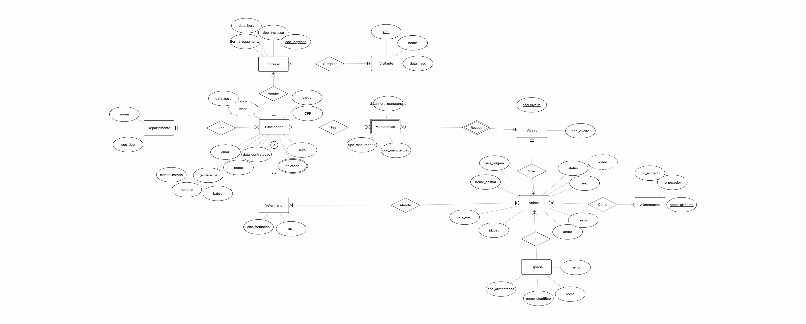

# 1. Modelo Entidade-Relacionamento

Para esse modelo, utilizamos as seguintes regras de negócio:

Um **ANIMAL** possui um número de identidade própria composto por 6 dígitos, nome, peso (em kg), altura (em cm), status (vivo ou morto), país de origem, sexo, data de nascimento e idade. Cada animal tem uma única **ESPÉCIE**, que é identificada pelo nome científico, e também possui nome popular, reino e tipo de alimentação. Uma espécie pode ter nenhum ou vários animais, mas um animal tem uma única espécie.

A **ALIMENTAÇÃO** de um animal é identificada pelo nome do alimento, com as informações de tipo de alimento (planta, grão ou carne) e o fornecedor. Só há um único fornecedor para cada tipo de alimento e a única informação necessária é o nome do fornecedor. Uma alimentação pode ser de nenhum ou vários animais e um animal pode ter um ou vários tipos de alimentação.

Um **VIVEIRO** é identificado por um código único de 4 dígitos e possui também um nome (tipo do viveiro: naturalista, fechado, aquático). Em um viveiro podem viver nenhum ou vários animais e um animal só vive em um único viveiro.

Uma **MANUTENÇÃO** é uma entidade fraca de chave composta identificada por um código de 10 dígitos, a data e hora em que foi realizada e o viveiro relacionado (código do viveiro). Também deve ter o tipo de manutenção (limpeza ou conserto). Uma manutenção acontece em um único viveiro e um viveiro pode ter nenhuma ou várias manutenções.

Um **DEPARTAMENTO** possui um código único de 3 dígitos e o nome do departamento.

Um **VETERINÁRIO** é identificado pelo CPF herdado de funcionário e possui um código único RQE de 7 dígitos e ano de formação. Ele é uma especialização de funcionário. Um veterinário pode cuidar de um ou vários animais e um animal possui um ou vários veterinários.

Um **FUNCIONÁRIO** é identificado pelo seu CPF e possui nome, sexo, data de nascimento e idade, data em que foi contratado, endereço com número, bairro e cidade/estado, telefone e email; ele pode ter vários telefones, mas possui um único email. Um departamento pode ter nenhum ou vários funcionários e os funcionários pertencem a um único departamento. Um veterinário é funcionário e podem haver um ou vários veterinários. Uma manutenção é feita por um ou vários funcionários e um funcionário pode fazer nenhuma ou várias manutenções. 

Um **INGRESSO** possui um código único de 15 dígitos, tipo de ingresso, data e hora da compra e forma de pagamento (pix, dinheiro, crédito ou débito). Um **VISITANTE** possui CPF, nome e data de nascimento. Um visitante pode comprar um ou vários ingressos e um ingresso pode ser comprado por um único visitante. Um ingresso é vendido por exatamente um funcionário e um funcionário pode vender nenhum ou vários ingressos.

DER desenvolvido a partir das regras de negócio.
Ferramenta utilizada: site [ERDPlus](https://erdplus.com).
