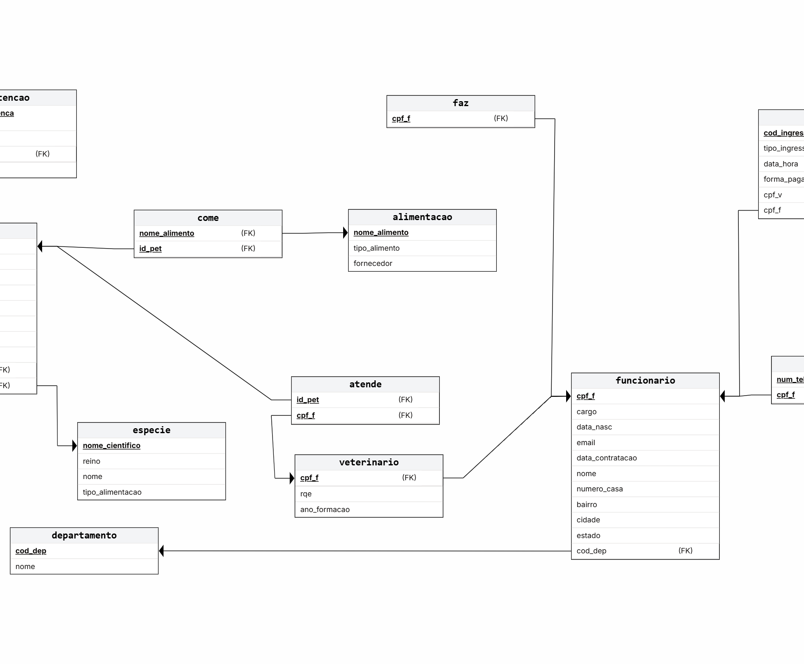

# 3. Modelo Relacional

Para o MR, seguimos as regras de negócio e as regras de construção do modelo. Os seguimos os seguintes raciocínios:

### Relacionamento **COMPRAR** *(Ingresso-Visitante)*:

**_N:1 (muitos ingressos para um visitante)_**

Pela regra, a PK de Visitante deve ir para a tabela Ingresso.

### Relacionamento **VENDER** *(Ingresso-Funcionário)*:

**_N:1 (muitos ingressos para um funcionário)_**

Pela regra, a PK de Funcionario deve ir para a tabela Ingresso.

### Relacionamento **TER** *(Departamento-Funcionario)*:

**_1:N (muitos funcionários para um departamento)_**

Pela regra, a PK de Departamento deve ir para a tabela Funcionario.

### Relacionamento **RECEBE** *(Manutenção-Viveiro)*:

**_N:1 (muitas manutenções para um viveiro)_**

Sendo entidade fraca e pela regra de modelos relacionais, a PK de Viveiro deve ir para a tabela manutenção.

### Relacionamento **FAZ** *(Funcionario-Manutencao)*:

**_N:N (muitos funcionários para muitas manutenções)_**

Deve-se criar uma tabela nova com as PKs de Manutenção e de Funcionário.

### Especialização Veterinário da tabela Funcionário:

Veterinário herda a PK de Funcionário.

### Relacionamento **ATENDE** *(Veterinário-Animal)*:

**_N:N (muitos animais para muitos veterinários)_**

Deve-se criar uma tabela nova com as chaves de Veterinário e Animal.

### Relacionamento **VIVE** *(Viveiro-Animal)*:

**_1:N (vários animais para um viveiro)_**

Pela regra, deve-se colocar a PK de Viveiro na tabela Animal.

### Relacionamento **É** *(Animal-Espécie)*:

**_N:1 (vários animais para uma espécie)_**

Pela regra, deve-se colocar a PK de Espécie na tabela Animal.

### Relacionamento **COME** *(Animal-Alimentação)*:

**_N:N (vários tipos de alimentação para vários animais)_**

Pela regra, deve-se criar uma nova tabela com as chaves de Alimentação e Animal.

### Atributo **Telefone** da tabela *Funcionario*:

Por ser multivalorado, cria-se nova tabela com chave composta, sendo o número de telefone e a FK vinda da tabela Funcionário.

